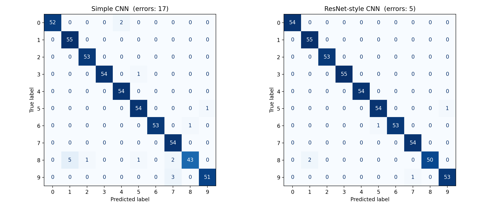
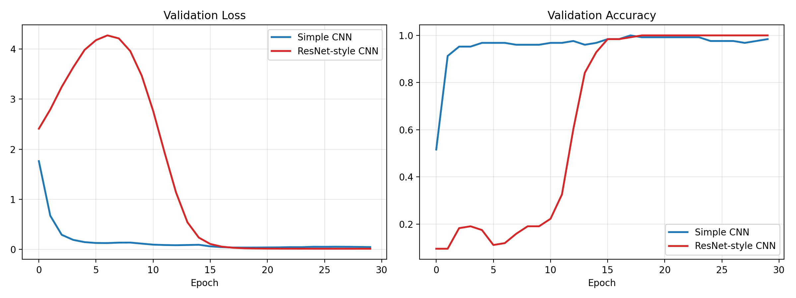

# CNN Architecture Comparison

A simple CNN compared with a ResNet-style CNN (with skip connections) on the same handwritten-digit image dataset, to see how network depth and structure affect classification performance.

## Overview

Both models are trained under identical conditions, so any difference in results comes from the architecture alone.

| Setting | Value |
|---|---|
| Dataset | scikit-learn Digits (1,797 grayscale images, 8x8 pixels, 10 classes) |
| Train/test split | 70/30, stratified (1,257 train / 540 test) |
| Optimizer | Adam (learning rate 0.001) |
| Batch size | 32 |
| Epochs | 30 |
| Validation | 10% of training data (test set kept untouched) |
| Seed | 42 |

## Models

- **Simple CNN:** 2 convolution + max-pooling blocks, then a dense classifier. No skip connections.
- **ResNet-style CNN:** a mini ResNet with 3 residual blocks (convolutions + Batch Normalization + skip connections) and Global Average Pooling.

## Results

| Model | Layers | Parameters | Train Acc | Test Acc | Test Loss | Test Errors | Train Time |
|---|---|---|---|---|---|---|---|
| Simple CNN | 7 | 35,914 | 100.00% | 97.04% | 0.1149 | 16 / 540 | 10.1 s |
| ResNet-style CNN | 27 | 152,138 | 100.00% | 99.26% | 0.0275 | 4 / 540 | 22.6 s |

Training times were measured on CPU and will vary by machine.

### Confusion matrices



- Both models struggle most with the digit **8**, whose loops blur into other shapes at 8x8 resolution.
- Simple CNN: 16 errors, with recall for digit 8 of only 0.827.
- ResNet-style CNN: 4 errors, with digits 0, 2, 3, 4, and 6 classified perfectly.

### Training curves



The Simple CNN learns faster at first. The ResNet-style model starts slowly (likely because Batch Normalization statistics take a while to settle on a small dataset), then ends higher and more stable.

### Robustness check (5 random seeds)

| Model | Mean test accuracy | Std |
|---|---|---|
| Simple CNN | 98.07% | 0.48% |
| ResNet-style CNN | 99.07% | 0.17% |

The ResNet-style model scored higher in all 5 seeds. The real gap is about **1 percentage point**; the Simple CNN's 97.04% in the main run was on the low side of its range.

## Conclusion

The ResNet-style CNN was more accurate and more stable, with fewer errors on the hard digit 8. The trade-off is about **4x more parameters** and roughly **2x longer training time**. The Simple CNN is still strong at about 98% accuracy with a quarter of the parameters, so the right choice depends on accuracy needs versus model size and speed.

## Limitations

- Digits is a small, easy dataset (8x8 images). The gap between architectures would likely be larger on harder data like CIFAR-10.
- The second model is a mini ResNet-style network trained from scratch, not the full ResNet-50 or VGG-16 with pretrained weights.
- The test set has 540 images, so single-run accuracy shifts by a few tenths of a percent between seeds.

## Tech Stack

Python, TensorFlow/Keras, scikit-learn, NumPy, Matplotlib

## How to Run

Open `YOUR_NOTEBOOK_NAME.ipynb` in Google Colab (or Jupyter) and run all cells. If running locally, first install the libraries:

```bash
pip install tensorflow scikit-learn numpy matplotlib
```

## Files

- `YOUR_NOTEBOOK_NAME.ipynb`: full code and output
- `confusion_matrices.png`: confusion matrices for both models
- `training_curves.png`: validation loss and accuracy per epoch
- `README.md`: project documentation

## Author

Poojashree
